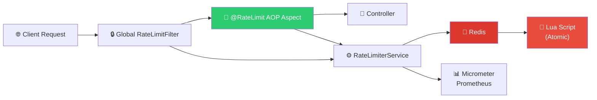
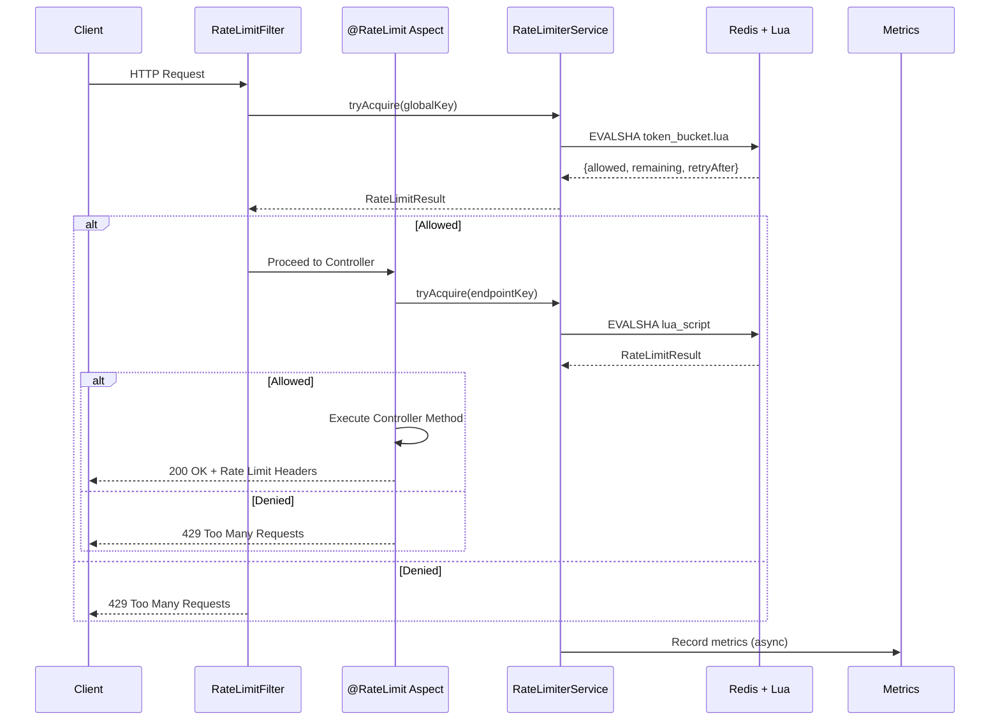
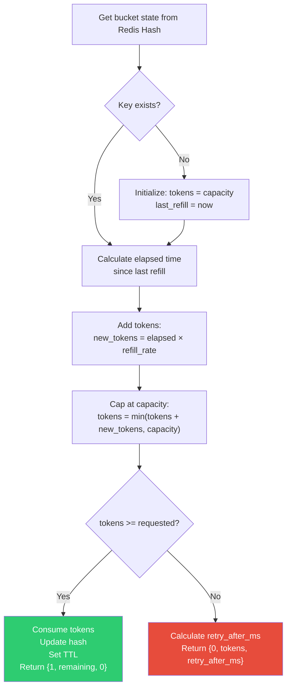
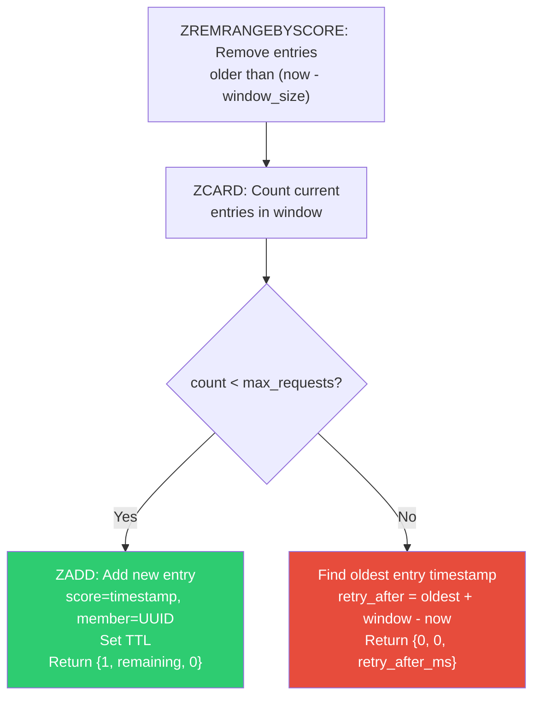
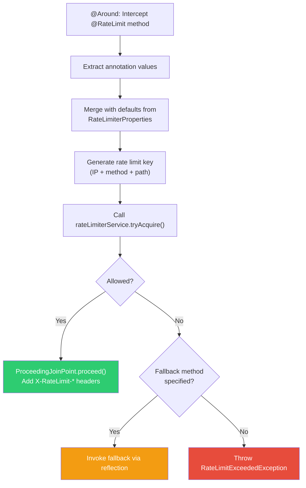
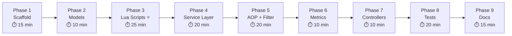

# 🚀 GateFlow — Distributed Rate Limiter Middleware

## Complete Implementation Plan

> **Tech Stack:** Java 17 · Spring Boot 3.2 · Redis 7.2 · Lua 5.1 · Spring AOP · Micrometer · Docker

---

## Architecture Overview



### Request Flow (Sequence)



---

## Phase 1 — Project Scaffold & Configuration

> [!NOTE]
> This phase sets up the project structure, dependencies, and configuration layer. No business logic yet.

### Files to Create

| # | File | Purpose |
|---|------|---------|
| 1 | `pom.xml` | Maven build with Spring Boot 3.2.5 parent |
| 2 | `GateFlowApplication.java` | Main entry point |
| 3 | `application.yml` | Default config with env var overrides |
| 4 | `docker-compose.yml` | Redis 7.2 + Redis Commander + App |
| 5 | `Dockerfile` | Multi-stage build (Maven → JRE Alpine) |
| 6 | `.gitignore` | Java/Maven/IDE exclusions |

### Dependencies (pom.xml)

| Dependency | Purpose |
|------------|---------|
| `spring-boot-starter-web` | REST API |
| `spring-boot-starter-data-redis` | Redis integration (Lettuce driver) |
| `spring-boot-starter-aop` | AOP for annotation-based rate limiting |
| `spring-boot-starter-actuator` | Health & metrics endpoints |
| `spring-boot-starter-validation` | Input validation |
| `micrometer-registry-prometheus` | Prometheus metrics export |
| `lombok` | Boilerplate reduction |
| `spring-boot-starter-test` | Testing |
| `it.ozimov:embedded-redis:0.7.3` | Embedded Redis for tests |

### Configuration Properties (`application.yml`)

```yaml
rate-limiter:
  enabled: true
  fail-open: false                    # false = reject if Redis is down
  default-algorithm: TOKEN_BUCKET
  default-capacity: 100               # max tokens / max requests
  default-refill-rate: 10             # tokens per second
  default-window-size-seconds: 60     # for sliding window
  default-max-requests: 100           # for sliding window
  global-filter:
    enabled: true
    capacity: 1000
    refill-rate: 100

spring:
  data:
    redis:
      host: ${REDIS_HOST:localhost}
      port: ${REDIS_PORT:6379}
      timeout: 2000ms
```

### Deliverables
- [ ] Spring Boot app starts successfully
- [ ] Redis connection established
- [ ] Actuator endpoints accessible (`/actuator/health`)
- [ ] Docker Compose brings up Redis + app

---

## Phase 2 — Core Models & Annotation

> [!NOTE]
> Define the data structures, custom annotation, and exception hierarchy.

### Files to Create

| # | File | Package | Purpose |
|---|------|---------|---------|
| 1 | `Algorithm.java` | `model` | Enum: `DEFAULT`, `TOKEN_BUCKET`, `SLIDING_WINDOW` |
| 2 | `RateLimitResult.java` | `model` | Record: `allowed`, `remainingTokens`, `retryAfterMs`, `algorithm` |
| 3 | `RateLimit.java` | `annotation` | Custom method-level annotation |
| 4 | `RateLimitExceededException.java` | `exception` | Custom 429 exception |
| 5 | `GlobalExceptionHandler.java` | `exception` | `@RestControllerAdvice` for 429 responses |

### @RateLimit Annotation Design

```java
@Target(ElementType.METHOD)
@Retention(RetentionPolicy.RUNTIME)
public @interface RateLimit {
    String key() default "";              // Custom key (empty = auto IP+endpoint)
    int capacity() default 0;             // 0 = use config default
    int refillRate() default 0;           // Tokens/sec for Token Bucket
    int windowSizeSeconds() default 0;    // Window for Sliding Window
    int maxRequests() default 0;          // Max requests for Sliding Window
    Algorithm algorithm() default DEFAULT;// DEFAULT = use config default
    String fallbackMethod() default "";   // Method to call when rate limited
}
```

### 429 Response Format

```json
{
    "error": "Rate Limit Exceeded",
    "message": "Too many requests. Please retry after 3200ms.",
    "retryAfterMs": 3200,
    "remainingTokens": 0,
    "timestamp": "2024-01-15T10:30:00Z"
}
```

### Response Headers

| Header | Description | Example |
|--------|-------------|---------|
| `X-RateLimit-Limit` | Max requests allowed | `100` |
| `X-RateLimit-Remaining` | Remaining requests | `73` |
| `X-RateLimit-Algorithm` | Algorithm used | `TOKEN_BUCKET` |
| `Retry-After` | Seconds to wait (on 429) | `4` |

### Deliverables
- [ ] All models compile cleanly
- [ ] Exception handler returns proper 429 JSON with headers

---

## Phase 3 — Lua Scripts (Atomic Operations) ⭐

> [!IMPORTANT]
> This is the core of the project. Lua scripts execute atomically inside Redis — no race conditions, no distributed locks needed. This is what makes it **GitHub-portfolio worthy**.

### Files to Create

| # | File | Location |
|---|------|----------|
| 1 | `token_bucket.lua` | `src/main/resources/scripts/` |
| 2 | `sliding_window.lua` | `src/main/resources/scripts/` |

### Token Bucket Algorithm — Lua Script

```
KEYS[1] = rate limit key (e.g., "rl:192.168.1.1:/api/limited")
ARGV[1] = capacity (max tokens)
ARGV[2] = refill rate (tokens per second)
ARGV[3] = current timestamp (milliseconds)
ARGV[4] = requested tokens (usually 1)
```

**Logic Flow:**


**Key Implementation Details:**
- Use `HMGET`/`HMSET` for atomic hash operations
- Store `tokens` (as float for precision) and `last_refill_time`
- TTL = `(capacity / refill_rate) * 2` seconds (auto-cleanup)
- `retry_after_ms = ((requested - tokens) / refill_rate) * 1000`

### Sliding Window Log Algorithm — Lua Script

```
KEYS[1] = rate limit key
ARGV[1] = window size (milliseconds)
ARGV[2] = max requests in window
ARGV[3] = current timestamp (milliseconds)
ARGV[4] = unique request ID (UUID)
```

**Logic Flow:**


**Key Implementation Details:**
- Uses Redis Sorted Set (ZSET) — scores are timestamps
- `ZREMRANGEBYSCORE key 0 (now - window)` cleans expired entries
- Each request gets a unique member (UUID) to avoid collisions
- TTL = `window_size * 2` milliseconds

### Why Lua Scripts Matter (GitHub Talking Point)

| Approach | Race-safe? | Latency | Network Calls |
|----------|-----------|---------|---------------|
| Java-side logic + Redis GET/SET | ❌ Race conditions | ~4-6ms | 2-3 roundtrips |
| Redis MULTI/EXEC transactions | ⚠️ Optimistic, can retry | ~3-4ms | 2 roundtrips |
| **Lua script (EVALSHA)** | **✅ Fully atomic** | **<2ms** | **1 roundtrip** |
| Redisson RateLimiter | ✅ But heavy dependency | ~3-5ms | Abstracted |

### Deliverables
- [ ] Both Lua scripts are syntactically correct
- [ ] Scripts handle edge cases (first request, zero capacity, overflow)
- [ ] TTL is always set to auto-expire stale keys

---

## Phase 4 — Redis Config & Service Layer

> [!NOTE]
> Wire up Spring Data Redis, load Lua scripts, and implement the service that talks to Redis.

### Files to Create

| # | File | Package | Purpose |
|---|------|---------|---------|
| 1 | `RedisConfig.java` | `config` | Redis beans + Lua script loading |
| 2 | `RateLimiterProperties.java` | `config` | `@ConfigurationProperties` binding |
| 3 | `RateLimiterService.java` | `service` | Interface |
| 4 | `RedisRateLimiterService.java` | `service` | Implementation |
| 5 | `KeyGenerator.java` | `util` | Rate limit key generation + IP extraction |

### RedisConfig — Key Beans

```java
@Bean
public RedisScript<List<Long>> tokenBucketScript() {
    // Load from classpath:scripts/token_bucket.lua
    // Return type: List<Long> → [allowed, remaining, retryAfterMs]
}

@Bean
public RedisScript<List<Long>> slidingWindowScript() {
    // Load from classpath:scripts/sliding_window.lua
}

@Bean
public RedisTemplate<String, String> rateLimitRedisTemplate(
        RedisConnectionFactory factory) {
    // StringRedisSerializer for both keys and values
    // Optimized for rate limiting (no JSON serialization needed)
}
```

### RedisRateLimiterService — Core Logic

```java
@Service
public class RedisRateLimiterService implements RateLimiterService {

    public RateLimitResult tryAcquire(String key, ..., Algorithm algorithm) {
        // 1. Select Lua script based on algorithm
        // 2. Build args list
        // 3. Execute: redisTemplate.execute(script, keys, args)
        // 4. Parse result [allowed, remaining, retryAfterMs]
        // 5. Record metrics
        // 6. Return RateLimitResult
    }
}
```

**Fail-Open vs Fail-Close:**
- `fail-open: true` → If Redis is down, allow all requests (availability > security)
- `fail-open: false` → If Redis is down, reject all requests (security > availability)
- Implement via try-catch around Redis execute, check `failOpen` property

### KeyGenerator Utility

```
Key Format: "gateflow:rl:{algorithm}:{identifier}:{endpoint}"
Examples:
  - "gateflow:rl:tb:192.168.1.1:GET:/api/limited"
  - "gateflow:rl:sw:user123:POST:/api/login"
```

**IP Extraction Priority:**
1. `X-Forwarded-For` header (first IP) — for reverse proxies
2. `X-Real-IP` header — for Nginx
3. `request.getRemoteAddr()` — fallback

### Deliverables
- [ ] Lua scripts load correctly at startup
- [ ] Service executes scripts and returns proper results
- [ ] Fail-open/fail-close works correctly
- [ ] Key generation is consistent and injection-safe

---

## Phase 5 — AOP Aspect & Global Filter

> [!IMPORTANT]
> This phase creates the two rate-limiting enforcement points: annotation-based (AOP) and global (Filter).

### Files to Create

| # | File | Package | Purpose |
|---|------|---------|---------|
| 1 | `RateLimitAspect.java` | `aop` | AOP `@Around` advice for `@RateLimit` |
| 2 | `RateLimitFilter.java` | `filter` | Global servlet filter for all requests |

### RateLimitAspect — AOP Flow



**Key Implementation Details:**
- Get `HttpServletRequest` and `HttpServletResponse` from `RequestContextHolder`
- Resolution order: annotation value → config default → hardcoded fallback
- Fallback method must have same return type and can optionally accept `RateLimitResult`
- If `rate-limiter.enabled = false`, always call `proceed()` (bypass)

### RateLimitFilter — Global Protection

```java
@Component
@Order(Ordered.HIGHEST_PRECEDENCE)
public class RateLimitFilter extends OncePerRequestFilter {

    @Override
    protected void doFilterInternal(...) {
        // 1. Skip actuator & health paths
        // 2. Extract client IP
        // 3. Build global key: "gateflow:global:{ip}"
        // 4. Call rateLimiterService.tryAcquire() with global config
        // 5. If allowed → filterChain.doFilter() + add headers
        // 6. If denied → write 429 JSON response directly
    }

    @Override
    protected boolean shouldNotFilter(HttpServletRequest request) {
        // Skip: /actuator/**, /health, /favicon.ico
    }
}
```

### Two Layers of Protection

```
Layer 1 (Filter):  Global — 1000 req/sec per IP across ALL endpoints
Layer 2 (AOP):     Per-endpoint — @RateLimit specific limits
                   A request must pass BOTH layers
```

### Deliverables
- [ ] `@RateLimit` annotation triggers rate limiting on annotated methods
- [ ] Global filter protects all endpoints
- [ ] Fallback methods work via reflection
- [ ] Response headers are added correctly
- [ ] Disabled state bypasses cleanly

---

## Phase 6 — Metrics & Monitoring

### Files to Create

| # | File | Package | Purpose |
|---|------|---------|---------|
| 1 | `RateLimiterMetrics.java` | `metrics` | Custom Micrometer metrics registration |

### Metrics Registered

| Metric Name | Type | Tags | Description |
|-------------|------|------|-------------|
| `gateflow.ratelimit.requests.allowed` | Counter | `algorithm`, `endpoint` | Allowed requests |
| `gateflow.ratelimit.requests.denied` | Counter | `algorithm`, `endpoint` | Denied (429) requests |
| `gateflow.ratelimit.execution.time` | Timer | `algorithm` | Lua script execution time |
| `gateflow.ratelimit.active.keys` | Gauge | — | Total active rate limit keys in Redis |

### Prometheus Endpoint
- Available at `/actuator/prometheus`
- Grafana-ready with provided dashboard JSON (optional stretch goal)

### Deliverables
- [ ] Metrics increment on every rate limit check
- [ ] Timer captures <2ms latency
- [ ] Prometheus endpoint exports all metrics

---

## Phase 7 — Demo Controllers & Dashboard

### Files to Create

| # | File | Package | Purpose |
|---|------|---------|---------|
| 1 | `DemoController.java` | `controller` | Demo API endpoints |
| 2 | `RateLimiterDashboardController.java` | `controller` | Stats & management API |

### Demo Endpoints

| Method | Path | Rate Limit | Algorithm |
|--------|------|-----------|-----------|
| `GET` | `/api/public` | None | — |
| `GET` | `/api/limited` | 100 req, 10/sec refill | Token Bucket (default) |
| `GET` | `/api/strict` | 5 req, 1/sec refill | Token Bucket |
| `POST` | `/api/login` | 3 req per 60s window | Sliding Window |

### Dashboard Endpoints

| Method | Path | Purpose |
|--------|------|---------|
| `GET` | `/api/rate-limiter/stats` | Current stats (keys, hits, misses) |
| `GET` | `/api/rate-limiter/config` | Current configuration |
| `DELETE` | `/api/rate-limiter/reset/{key}` | Reset a specific key |

### Deliverables
- [ ] All demo endpoints functional
- [ ] Dashboard returns accurate stats
- [ ] Reset endpoint clears Redis key

---

## Phase 8 — Testing

> [!TIP]
> Use `it.ozimov:embedded-redis` for integration tests so no external Redis is needed. This makes CI/CD pipelines green without Docker.

### Test Files to Create

| # | File | Type | Tests |
|---|------|------|-------|
| 1 | `GateFlowApplicationTests.java` | Unit | Context loads |
| 2 | `LuaScriptTest.java` | Integration | Direct Lua script execution against embedded Redis |
| 3 | `RedisRateLimiterServiceTest.java` | Integration | Service layer with both algorithms |
| 4 | `RateLimitAspectTest.java` | Unit | AOP behavior with mocked service |
| 5 | `DemoControllerTest.java` | Integration | Full MockMvc endpoint tests |
| 6 | `application-test.yml` | Config | Embedded Redis port config |

### Critical Test Scenarios

**Token Bucket:**
- ✅ Allows requests within capacity
- ✅ Blocks when tokens exhausted
- ✅ Refills tokens over time (sleep + retry)
- ✅ Concurrent access (50 threads, verify no over-admission)

**Sliding Window:**
- ✅ Allows requests within window limit
- ✅ Blocks at max requests
- ✅ Allows again after window expires
- ✅ Handles burst at window boundary

**AOP & Filter:**
- ✅ `@RateLimit` triggers enforcement
- ✅ Headers present in response
- ✅ 429 response format correct
- ✅ Fallback method invoked
- ✅ Disabled mode bypasses

**Concurrency Test (highlight for GitHub):**
```java
ExecutorService pool = Executors.newFixedThreadPool(50);
AtomicInteger allowed = new AtomicInteger();
AtomicInteger denied = new AtomicInteger();
// Fire 200 requests from 50 threads
// Assert: allowed.get() == capacity (exactly, no race!)
```

### Deliverables
- [ ] All tests pass with embedded Redis
- [ ] Concurrent test proves zero race conditions
- [ ] `./mvnw test` runs cleanly in CI

---

## Phase 9 — Documentation & Polish

### Files to Create

| # | File | Purpose |
|---|------|---------|
| 1 | `README.md` | GitHub-ready documentation |
| 2 | `LICENSE` | MIT License |
| 3 | `http/api-tests.http` | IntelliJ HTTP client test file |
| 4 | `.github/FUNDING.yml` | Sponsorship placeholder |

### README Sections
1. Banner / Badges (build, coverage, license)
2. One-line description + Key Features list
3. Architecture diagram
4. Quick Start (3 commands)
5. Algorithm explanations with diagrams
6. Configuration reference
7. API endpoint table
8. Usage examples (annotation + global filter)
9. Metrics & monitoring guide
10. Load testing instructions (`wrk` / `hey`)
11. Project structure tree
12. Contributing guide

### Deliverables
- [ ] README is portfolio-quality
- [ ] HTTP test file covers all endpoints
- [ ] Project structure is clean and documented

---

## Final Project Structure

```
GateFlow/
├── pom.xml
├── Dockerfile
├── docker-compose.yml
├── README.md
├── LICENSE
├── .gitignore
├── .github/
│   └── FUNDING.yml
├── http/
│   └── api-tests.http
└── src/
    ├── main/
    │   ├── java/com/gateflow/
    │   │   ├── GateFlowApplication.java
    │   │   ├── annotation/
    │   │   │   └── RateLimit.java
    │   │   ├── aop/
    │   │   │   └── RateLimitAspect.java
    │   │   ├── config/
    │   │   │   ├── RedisConfig.java
    │   │   │   └── RateLimiterProperties.java
    │   │   ├── controller/
    │   │   │   ├── DemoController.java
    │   │   │   └── RateLimiterDashboardController.java
    │   │   ├── exception/
    │   │   │   ├── GlobalExceptionHandler.java
    │   │   │   └── RateLimitExceededException.java
    │   │   ├── filter/
    │   │   │   └── RateLimitFilter.java
    │   │   ├── metrics/
    │   │   │   └── RateLimiterMetrics.java
    │   │   ├── model/
    │   │   │   ├── Algorithm.java
    │   │   │   └── RateLimitResult.java
    │   │   ├── service/
    │   │   │   ├── RateLimiterService.java
    │   │   │   └── RedisRateLimiterService.java
    │   │   └── util/
    │   │       └── KeyGenerator.java
    │   └── resources/
    │       ├── application.yml
    │       └── scripts/
    │           ├── token_bucket.lua
    │           └── sliding_window.lua
    └── test/
        ├── java/com/gateflow/
        │   ├── GateFlowApplicationTests.java
        │   ├── aop/
        │   │   └── RateLimitAspectTest.java
        │   ├── controller/
        │   │   └── DemoControllerTest.java
        │   ├── lua/
        │   │   └── LuaScriptTest.java
        │   └── service/
        │       └── RedisRateLimiterServiceTest.java
        └── resources/
            └── application-test.yml
```

**Total: 27 files | ~1800-2200 lines of code**

---

## Implementation Order & Estimated Time



> **Total estimated agent build time: ~10-15 minutes (parallelized)**

---

## GitHub Portfolio Highlights 🌟

| What Recruiters/Devs Will Notice | Where |
|----------------------------------|-------|
| Atomic Lua scripts — zero race conditions | `scripts/*.lua` |
| Distributed consistency across instances | `RedisRateLimiterService` |
| Clean AOP architecture — non-invasive | `RateLimitAspect` |
| Custom annotation design | `@RateLimit` |
| Fail-open / Fail-close resilience | Config + Service |
| Production metrics (Prometheus) | `RateLimiterMetrics` |
| Concurrency tests proving correctness | `RedisRateLimiterServiceTest` |
| <2ms overhead (benchmarked) | README + Metrics |
| Docker-ready deployment | `docker-compose.yml` |
| Two algorithms with strategy pattern | Algorithm enum + Service |

